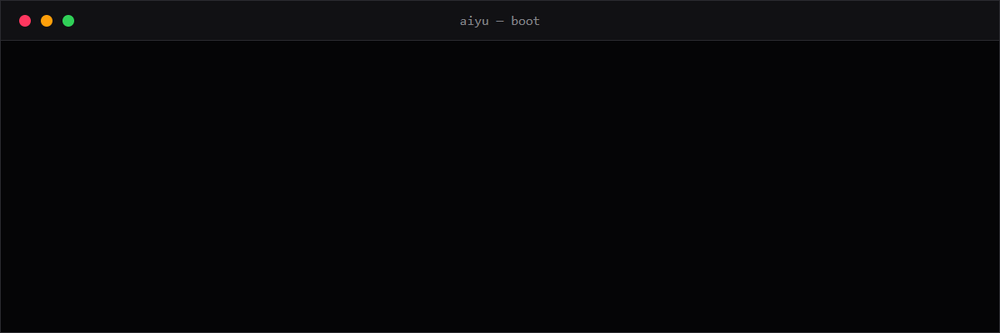

  
  
  
  

  
  

## About

Software Engineer at [Adrosonic](https://www.adrosonic.com/) in Mumbai, delivering client projects in C#, .NET Core, Azure Functions and APIM. Outside of work I design and ship full-stack systems, mostly in TypeScript and Kotlin.

I work spec-first with AI coding agents. The architecture, threat model and phased backlog are written down as context the agent can read (`CLAUDE.md`, decision logs) before any code exists. The agent implements against that contract. I own review, integration and hardening.

- **Currently building:** [BetweenUs](https://github.com/aiyu-ayaan/BetweenUs), an end-to-end encrypted communication platform across desktop, web and Android.
- **Focus areas:** agentic development workflows, LLM integration, applied cryptography, microservice architecture.
- **Writing and more work:** [blog](https://me.aiyu.co.in/blogs), [project write-ups](https://me.aiyu.co.in/projects) and a [contact form](https://me.aiyu.co.in/contact-us) on my portfolio.

## Featured projects

| Project | Summary | Stack |
| :-- | :-- | :-- |
| [**BetweenUs**](https://github.com/aiyu-ayaan/BetweenUs) | End-to-end encrypted, Discord-style messaging and calls for desktop, web and Android. Eight NestJS services behind Nginx. Messages are encrypted on the client with AES-256-GCM, so the server stores only ciphertext. Calls use a peer-to-peer WebRTC mesh with no media server. | NestJS, TypeScript, Electron, React, Jetpack Compose, WebRTC, PostgreSQL, Redis |
| [**LoadPulse**](https://github.com/aiyu-ayaan/LoadPulse) | Performance testing workspace built on k6. Live dashboard over Socket.IO, concurrent test runs, cron and API triggers, and k6 scripts generated from plain-English descriptions. Secured with GitHub OAuth and TOTP 2FA. | React, Express, MongoDB, Socket.IO, k6, Redis, Gemini |
| [**Aiyu**](https://github.com/aiyu-ayaan/Aiyu) | The portfolio and CMS behind [me.aiyu.co.in](https://me.aiyu.co.in/). 52 themes, a Markdown blog with Notion sync, a LaTeX resume editor, a visual cron scheduler with encrypted secrets, and an MCP server. | Next.js 16, React 19, PostgreSQL, Prisma, Gemini, Docker |

<b>More projects</b>

 

| Project | Summary |
| :-- | :-- |
| [**Agent-Verse**](https://github.com/aiyu-ayaan/Agent-Verse) | Multi-agent orchestration framework for Android. |
| [**CodeDock**](https://github.com/aiyu-ayaan/CodeDock) | Self-hosted Codespaces alternative that provisions code-server containers through the Docker SDK. Written in Go. |
| [**CodePilot**](https://github.com/aiyu-ayaan/Code-Pilot) | Local-first CI/CD dashboard that runs GitHub Actions with `nektos/act`. |
| [**Roadlyn**](https://github.com/aiyu-ayaan/Roadlyn) | AI roadmap SaaS. LangChain and the Vercel AI SDK on Fastify, with BullMQ jobs. |
| [**Domus**](https://github.com/aiyu-ayaan/Domus) | Local-first smart home hub for a home server. |
| [**BIT App**](https://github.com/aiyu-ayaan/BIT-App) | Campus app for BIT Mesra. Used by 1,000+ students, rated 4.7/5 on Google Play. |
| [**TTS-Engine**](https://github.com/aiyu-ayaan/tts-engine) | Android text-to-speech library published on JitPack, 500+ downloads. |

## Experience

| Period | Role | Highlights |
| :-- | :-- | :-- |
| Jun 2025 – Present | **Software Engineer**, Adrosonic | Own delivery on two live client projects in C#, .NET Core, Azure Functions and APIM. |
| Dec 2024 – Jun 2025 | **Software Engineer (Trainee)**, Adrosonic | Built a Dynamics 365 + Instanda integration proof of concept that cut process automation time by 40%. |
| Jul 2022 – Mar 2023 | **Android Developer Intern**, BeyondSchool | Shipped text-to-speech and speech-to-text accessibility (+35% engagement) and gamification (+40% retention). |

**Education:** Master of Computer Applications (2023 – 2025, CGPA 8.1) and Bachelor of Computer Applications (2019 – 2022, CGPA 8.2), Birla Institute of Technology, Mesra.

## Tech stack

| Area | Tools |
| :-- | :-- |
| Languages | TypeScript, Kotlin, Python, C#, Go, Java, SQL |
| Backend | NestJS, Fastify, FastAPI, .NET Core, Azure Functions, APIM, WebSockets, WebRTC |
| Frontend and mobile | Next.js, React, Tailwind, Electron, Jetpack Compose, Kotlin Multiplatform |
| AI and agents | Gemini, OpenAI, Claude, LangChain, Vercel AI SDK, MCP, n8n |
| Data | PostgreSQL, MongoDB, Redis, Prisma, Firebase, BullMQ |
| Infrastructure | Docker, Nginx, Azure, GitHub Actions, pnpm + Turborepo |

## GitHub activity

  
  

  

Stat cards are generated by <a href="scripts/generate-stats.mjs"><code>scripts/generate-stats.mjs</code></a> and refreshed daily by a GitHub Action in this repository. The header is a <a href="https://github.com/heygen-com/hyperframes">HyperFrames</a> composition in <a href="hyperframes/profile"><code>hyperframes/profile</code></a>, in the same style as the story on my portfolio.
