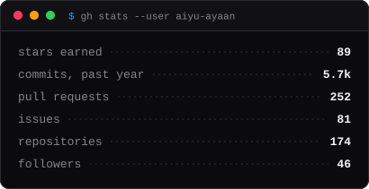
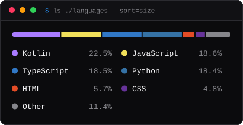
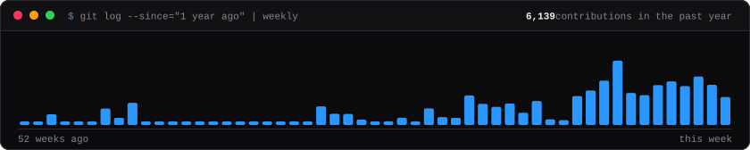

<a href="https://me.aiyu.co.in/">
  
</a>

<p align="center">
  <a href="https://me.aiyu.co.in/"><code>[ portfolio ]</code></a>
  <a href="https://me.aiyu.co.in/projects"><code>[ projects ]</code></a>
  <a href="https://me.aiyu.co.in/blogs"><code>[ blogs ]</code></a>
  <a href="https://me.aiyu.co.in/apps"><code>[ apps ]</code></a>
  <a href="https://me.aiyu.co.in/api/resume"><code>[ resume ]</code></a>
  <a href="https://me.aiyu.co.in/contact-us"><code>[ contact-me ]</code></a>
</p>

<p align="center">
  <a href="https://github.com/aiyu-ayaan"></a>
  <a href="https://github.com/aiyu-ayaan"></a>
  <a href="https://wakatime.com/@3a4240f0-6bea-4626-be2a-1129790e4336"></a>
</p>

### `$ whoami`

Software engineer in Mumbai. By day I write C#, .NET Core, Azure Functions and APIM for client projects at [Adrosonic](https://www.adrosonic.com/). The rest of the time I build my own things, mostly in TypeScript and Kotlin.

I work spec-first with coding agents. Before any code gets written I put the architecture, the threat model and a phased backlog into files the agent can read (`CLAUDE.md`, decision logs). The agent builds against that contract, and I do the review, integration and hardening. On [BetweenUs](https://github.com/aiyu-ayaan/BetweenUs) that review caught three authorization flaws in agent-written code before they shipped.

The longer version, starting from a calculator in C that would not compile, is on [my portfolio](https://me.aiyu.co.in/).

### `$ ls ./projects`

| Project | What it is | Built with |
| :-- | :-- | :-- |
| [**BetweenUs**](https://github.com/aiyu-ayaan/BetweenUs) | End-to-end encrypted, Discord-style chat and calls with desktop, web and Android clients. 8 NestJS services behind Nginx. Messages are encrypted on the client with AES-256-GCM, so the server only stores ciphertext. Calls run over a peer-to-peer WebRTC mesh with no media server. | NestJS, TypeScript, Electron, React, Jetpack Compose, WebRTC, PostgreSQL, Redis |
| [**LoadPulse**](https://github.com/aiyu-ayaan/LoadPulse) | Performance testing workspace on top of k6. Live dashboard over Socket.IO, concurrent runs, cron and API triggers, and k6 scripts generated from a plain-English description. | React, Express, MongoDB, Socket.IO, k6, Redis, Gemini |
| [**Aiyu**](https://github.com/aiyu-ayaan/Aiyu) | The portfolio and CMS behind [me.aiyu.co.in](https://me.aiyu.co.in/). 52 themes, a Markdown blog with Notion sync, a LaTeX resume editor, a visual cron scheduler with encrypted secrets, and an MCP server. | Next.js 16, React 19, PostgreSQL, Prisma, Gemini, Docker |

<details>
<summary><code>$ ls ./projects --all</code></summary>
<br>

- [**Agent-Verse**](https://github.com/aiyu-ayaan/Agent-Verse): multi-agent orchestration framework for Android.
- [**CodeDock**](https://github.com/aiyu-ayaan/CodeDock): self-hosted Codespaces alternative that provisions code-server containers through the Docker SDK. Written in Go.
- [**CodePilot**](https://github.com/aiyu-ayaan/Code-Pilot): local-first CI/CD dashboard that runs GitHub Actions with `nektos/act`.
- [**Roadlyn**](https://github.com/aiyu-ayaan/Roadlyn): AI roadmap SaaS. LangChain and the Vercel AI SDK on Fastify, with BullMQ jobs.
- [**Domus**](https://github.com/aiyu-ayaan/Domus): local-first smart home hub for a home server.
- [**BIT App**](https://github.com/aiyu-ayaan/BIT-App): campus app for BIT Mesra. 1,000+ students, 4.7/5 on Google Play.
- [**TTS-Engine**](https://github.com/aiyu-ayaan/tts-engine): Android text-to-speech library on JitPack, 500+ downloads.

</details>

### `$ cat experience.log`

| When | Where | What |
| :-- | :-- | :-- |
| Jun 2025 – now | **Adrosonic**, Software Engineer | Delivery on two live client projects in C#, .NET Core, Azure Functions and APIM. |
| Dec 2024 – Jun 2025 | **Adrosonic**, Software Engineer (Trainee) | Built a Dynamics 365 + Instanda integration POC that cut process automation time by 40%. |
| Jul 2022 – Mar 2023 | **BeyondSchool**, Android Developer Intern | Shipped text-to-speech and speech-to-text accessibility (+35% engagement) and gamification (+40% retention). |

MCA (2023 – 2025) and BCA (2019 – 2022) from Birla Institute of Technology, Mesra.

### `$ cat stack.txt`

```text
languages   TypeScript  Kotlin  Python  C#  Go  Java  SQL
backend     NestJS  Fastify  FastAPI  .NET Core  Azure Functions  APIM  WebSockets  WebRTC
frontend    Next.js  React  Tailwind  Electron  Jetpack Compose  Kotlin Multiplatform
ai          Gemini  OpenAI  Claude  LangChain  Vercel AI SDK  MCP  n8n
data        PostgreSQL  MongoDB  Redis  Prisma  Firebase  BullMQ
infra       Docker  Nginx  Azure  GitHub Actions  pnpm + Turborepo
```

### `$ gh stats`

<p align="center">
  
  
</p>
<p align="center">
  
</p>

<sub>Generated by <a href="scripts/generate-stats.mjs"><code>scripts/generate-stats.mjs</code></a> and refreshed daily by a GitHub Action in this repo.</sub>

### `$ ./contact --me`

[Portfolio](https://me.aiyu.co.in/) · [Resume](https://me.aiyu.co.in/api/resume) · [LinkedIn](https://www.linkedin.com/in/aiyu/) · [Email](mailto:ayaan35200@gmail.com) · [Instagram](https://www.instagram.com/aiyu.dev_/) · [Buy me a coffee](https://buymeacoffee.com/aiyuayaan)

<p align="right"><code>/eof</code></p>
