<a href="https://me.aiyu.co.in/">
  
</a>

<!-- links:start -->

  
  
  
  

<!-- links:end -->

  
  

  

  

## About

<!-- about:start -->
Software Engineer at [Adrosonic](https://www.adrosonic.com/) in Mumbai, delivering client projects in C#, .NET Core, Azure Functions and APIM. Outside of work I design and ship full-stack systems, mostly in TypeScript and Kotlin.

I work spec-first with AI coding agents. The architecture, threat model and phased backlog are written down as context the agent can read (`CLAUDE.md`, decision logs) before any code exists. The agent implements against that contract. I own review, integration and hardening.

- **Currently building:** [BetweenUs](https://github.com/aiyu-ayaan/BetweenUs), an end-to-end encrypted communication platform across desktop, web and Android.
- **Focus areas:** agentic development workflows, LLM integration, applied cryptography, microservice architecture.
- **Writing and more work:** [blog](https://me.aiyu.co.in/blogs), [project write-ups](https://me.aiyu.co.in/projects) and a [contact form](https://me.aiyu.co.in/contact-us) on my portfolio.
<!-- about:end -->

## Latest projects

The four repositories I pushed to most recently. This section rebuilds itself every six hours, so it always shows what I am working on now.

<!-- latest-projects:start -->

  <a href="https://github.com/aiyu-ayaan/film-studio-agents"></a>
  <a href="https://github.com/aiyu-ayaan/VS-Code-Settings"></a>

  
  <a href="https://github.com/aiyu-ayaan/Findex-Rust"></a>

<!-- latest-projects:end -->

  

## Featured projects

<!-- featured-projects:start -->

  <a href="https://github.com/aiyu-ayaan/BetweenUs"></a>
  <a href="https://github.com/aiyu-ayaan/Aiyu"></a>

  <a href="https://github.com/aiyu-ayaan/Findex"></a>
  <a href="https://github.com/aiyu-ayaan/Pull"></a>

  <a href="https://github.com/aiyu-ayaan/Kinema"></a>
  <a href="https://github.com/aiyu-ayaan/Domus"></a>

  <a href="https://github.com/aiyu-ayaan/Switchboard"></a>
  <a href="https://github.com/aiyu-ayaan/Rewire"></a>

Text version

 

| Project | Summary | Stack | Platforms |
| :-- | :-- | :-- | :-- |
| [**BetweenUs**](https://github.com/aiyu-ayaan/BetweenUs) | End-to-end encrypted, Discord-style messaging and calls for desktop, web and Android. Eight NestJS services behind Nginx. Messages are encrypted on the client with AES-256-GCM, so the server stores only ciphertext. Calls use a peer-to-peer WebRTC mesh with no media server. | NestJS, TypeScript, Electron, React, Jetpack Compose, WebRTC, PostgreSQL, Redis | desktop, web, android, server |
| [**Aiyu**](https://github.com/aiyu-ayaan/Aiyu) | The portfolio and CMS behind [me.aiyu.co.in](https://me.aiyu.co.in/). 52 themes, a Markdown blog with Notion sync, a LaTeX resume editor, a visual cron scheduler with encrypted secrets, and an MCP server. | Next.js 16, React 19, PostgreSQL, Prisma, Gemini, Docker | web, server |
| [**Findex**](https://github.com/aiyu-ayaan/Findex) | Android file manager with multi-tab and dual-pane browsing, a storage analyzer, duplicate finder, cleaner, archive tools and a recycle bin. Privacy-focused. | Kotlin, Jetpack Compose, Material 3 Expressive | android |
| [**Pull**](https://github.com/aiyu-ayaan/Pull) | Android download manager. Segmented multi-connection HTTP, torrents and magnet links, video sites through yt-dlp, and a built-in browser with an ad blocker. | Kotlin, Material 3 Expressive | android |
| [**Kinema**](https://github.com/aiyu-ayaan/Kinema) | Self-hosted media server, a lightweight alternative to Plex and Jellyfin. Direct play first, near-zero idle CPU, TMDB metadata and family profiles. Runs on a Raspberry Pi. | Rust, web, desktop, Android | server, web, desktop, android |
| [**Domus**](https://github.com/aiyu-ayaan/Domus) | Local-first smart-home hub. Tuya, Tapo, Xiaomi, Hue and MQTT/Zigbee2MQTT devices, a built-in Matter bridge for Google Home, Apple Home and Alexa, energy bill tracking and automations. | Rust, web, desktop, Android | server, web, desktop, android |
| [**Switchboard**](https://github.com/aiyu-ayaan/Switchboard) | Control your PC from your phone: brightness and contrast for every monitor over DDC/CI, volume, media playback and power. End-to-end encrypted on your own network, paired by QR code. | Rust daemon, Electron, Kotlin | desktop, android |
| [**Rewire**](https://github.com/aiyu-ayaan/Rewire) | Android app that reduces unwanted habits by adding intentional friction before distracting apps open. It creates a pause, lets you choose, and shows your own patterns. No punishment, no surveillance. | Kotlin, Android | android |

<!-- featured-projects:end -->

### How BetweenUs is built

  <a href="https://github.com/aiyu-ayaan/BetweenUs#readme"></a>

<b>More projects</b>

 

<!-- more-projects:start -->
| Project | Summary |
| :-- | :-- |
| [**Unpack**](https://github.com/aiyu-ayaan/Unpack) | Installs anything on Linux in one drop: `.deb`, `.rpm`, AppImage, Flatpak, Snap, scripts, archives and git URLs. Detects the distro, shows the plan, then installs, tracks and uninstalls. Rust and Tauri. |
| [**Monolith**](https://github.com/aiyu-ayaan/Monolith) | Single-container backend suite in Rust: multi-app SQLite, compiled access rules, auth, realtime, sync and an embedded admin UI. |
| [**RideLink**](https://github.com/aiyu-ayaan/RideLink) | Open-source TVS Connect alternative for the TVS Ntorq 125. Turn-by-turn arrows on the scooter display, caller ID and ride analytics, with no account and no cloud. |
| [**Parley**](https://github.com/aiyu-ayaan/Parley) | Lightweight multi-account WhatsApp desktop app for Linux, built with Go and Wails instead of Electron. |
| [**Agent-Verse**](https://github.com/aiyu-ayaan/Agent-Verse) | Multi-agent orchestration framework for Android. |
| [**CodeDock**](https://github.com/aiyu-ayaan/CodeDock) | Self-hosted Codespaces alternative that provisions code-server containers through the Docker SDK. Written in Go. |
| [**CodePilot**](https://github.com/aiyu-ayaan/Code-Pilot) | Local-first CI/CD dashboard that runs GitHub Actions with `nektos/act`. |
| [**Roadlyn**](https://github.com/aiyu-ayaan/Roadlyn) | AI roadmap SaaS. LangChain and the Vercel AI SDK on Fastify, with BullMQ jobs. |
| [**BIT App**](https://github.com/aiyu-ayaan/BIT-App) | Campus app for BIT Mesra. Used by 1,000+ students, rated 4.7/5 on Google Play. |
| [**TTS-Engine**](https://github.com/aiyu-ayaan/tts-engine) | Android text-to-speech library published on JitPack, 500+ downloads. |
<!-- more-projects:end -->

## Experience

  

Text version

 

<!-- experience:start -->
| Period | Role | Highlights |
| :-- | :-- | :-- |
| Jun 2025 – Present | **Software Engineer**, Adrosonic | Own delivery on two live client projects in C#, .NET Core, Azure Functions and APIM. |
| Dec 2024 – Jun 2025 | **Software Engineer (Trainee)**, Adrosonic | Built a Dynamics 365 + Instanda integration proof of concept that cut process automation time by 40%. |
| Jul 2022 – Mar 2023 | **Android Developer Intern**, BeyondSchool | Shipped text-to-speech and speech-to-text accessibility (+35% engagement) and gamification (+40% retention). |
<!-- experience:end -->

<!-- education:start -->
**Education:** Master of Computer Applications (2023 – 2025, CGPA 8.1), Birla Institute of Technology, Mesra; Bachelor of Computer Applications (2019 – 2022, CGPA 8.2), Birla Institute of Technology, Mesra.
<!-- education:end -->

## Tech stack

  

Text version

 

<!-- stack:start -->
| Area | Tools |
| :-- | :-- |
| Languages | TypeScript, Kotlin, Rust, Python, C#, Go, Java, SQL |
| Backend | NestJS, Fastify, FastAPI, .NET Core, Azure Functions, APIM, WebSockets, WebRTC |
| Frontend and mobile | Next.js, React, Tailwind, Electron, Tauri, Jetpack Compose, Kotlin Multiplatform |
| AI and agents | Claude, Gemini, OpenAI, Vercel AI SDK, MCP, n8n |
| Data | PostgreSQL, MongoDB, Redis, Prisma, Firebase, BullMQ |
| Infrastructure | Docker, Nginx, Azure, GitHub Actions, pnpm + Turborepo |
<!-- stack:end -->

## GitHub activity

  <a href="https://github.com/aiyu-ayaan?tab=repositories"></a>

  
  

Every card on this page is a hand-built SVG: the 3D solids are projected to plain paths by <a href="scripts/generate-stats.mjs"><code>scripts/generate-stats.mjs</code></a>, which has no dependencies, and the motion is CSS inside the image. Each data file is checked against a schema in <a href="data/schema"><code>data/schema</code></a> before anything is built. A GitHub Action in this repository regenerates the cards and the latest-projects links every six hours. The hero, stack and timeline content and every text section on this page live as JSON in <a href="data"><code>data/</code></a>.
